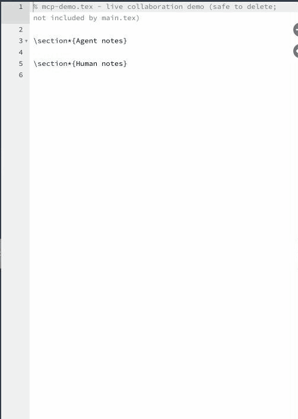

# Overleaf MCP

[](https://www.npmjs.com/package/overleaf-mcp-rt)
[](https://www.npmjs.com/package/overleaf-mcp-rt)
[](LICENSE)
[](https://nodejs.org/)

> **A real-time [Model Context Protocol](https://modelcontextprotocol.io/) server for Overleaf — self-hosted Community Edition / Server Pro *and* overleaf.com. No git-bridge, no fork, no extra infrastructure.**

Overleaf MCP lets AI coding agents read, edit, comment on and compile LaTeX projects on your own Overleaf server or on [overleaf.com](https://www.overleaf.com). It speaks the same live editing protocol as Overleaf's own editor, so the agent's edits show up in the browser as a collaborator typing: no "file changed externally" toast, and people working in the same file are never interrupted.

<p align="center">
  
  <br>
  <em>An agent and a person editing the same file at the same time.</em>
</p>

It is published on npm as [`overleaf-mcp-rt`](https://www.npmjs.com/package/overleaf-mcp-rt) (`rt` for real-time) and works with any MCP client.

## Table of contents

- [Installation](#installation)
- [Quick start](#quick-start)
- [Multiple hosts](#multiple-hosts)
- [Agent skills](#agent-skills)
- [Tools](#tools)
- [Supported Overleaf servers](#supported-overleaf-servers)
- [Why real-time?](#why-real-time)
- [Contributing](#contributing)
- [License](#license)
- [Acknowledgements](#acknowledgements)

More detail lives in [`docs/`](docs/): [configuration and login](docs/configuration.md), the [tool reference](docs/tools.md), and [developing](docs/development.md).

## Installation

You need Node.js ≥ 20. Nothing is installed on the Overleaf server.

### As a plugin (recommended)

The plugin bundles the MCP server with the [agent skills](#agent-skills) and two slash commands.

| Harness | Install |
|---|---|
| **Claude Code** | `/plugin marketplace add DanielHou315/overleaf-mcp-rt` then `/plugin install overleaf-mcp-rt@overleaf-mcp-rt` |
| **Codex** | `codex plugin marketplace add DanielHou315/overleaf-mcp-rt` then `codex plugin add overleaf-mcp-rt@overleaf-mcp-rt` |
| **Cursor** | Add this repository as a plugin marketplace, then install `overleaf-mcp-rt` |

### As an MCP server

For any other MCP client, add the server to its config:

```json
{
  "mcpServers": {
    "overleaf": {
      "command": "npx",
      "args": ["-y", "overleaf-mcp-rt@latest"]
    }
  }
}
```

The server reads the credentials that `login` saves (see [Quick start](#quick-start)). If you would rather configure it in place, set `OVERLEAF_URL` and `OVERLEAF_SESSION_COOKIE` in the entry's `env`. Is your Overleaf behind an auth proxy such as Cloudflare Access? See [configuration](docs/configuration.md#behind-a-reverse-proxy).

## Quick start

```bash
# 1. Sign in. A browser window opens; log in as usual and it closes itself.
npx overleaf-mcp-rt login --url https://overleaf.example.com --browser

# 2. Check the connection.
npx overleaf-mcp-rt diagnose

# 3. List your projects.
npx overleaf-mcp-rt ls
```

Then ask your agent something like *"list my Overleaf projects"* or *"fix the compile error in my thesis"*.

For overleaf.com, use `--url https://www.overleaf.com`. On a machine without a browser, `login` also takes a pasted cookie or an email and password — see [logging in](docs/configuration.md#logging-in).

## Multiple hosts

One server can be logged in to several Overleaf instances at once. Run `login` once for each:

```bash
npx overleaf-mcp-rt login --url https://tex.example.org --browser
npx overleaf-mcp-rt login --url https://www.overleaf.com --name overleaf.com --browser
npx overleaf-mcp-rt hosts     # list them
```

The first host is the default. Every tool takes an optional `host` argument to pick another. More in [configuration](docs/configuration.md#multiple-hosts).

## Agent skills

Skills are short instructions that an agent loads only when it needs them. They teach it to use these tools well.

| Skill | Teaches |
|---|---|
| `overleaf-setup` | Installing, logging in, multiple hosts, and what each auth or config error means. |
| `overleaf-editing` | Making small, exact edits that fit around what people are typing. |
| `overleaf-latex-workflow` | Finding the main document, compiling, reading the errors, and leaving the project building. |
| `overleaf-comments` | When to comment instead of edit, and how to sign, reply to and resolve comments. |

The plugin installs them, along with the `/overleaf-login` and `/overleaf-status` commands. Without the plugin, copy them into your agent's skills directory:

```bash
npx overleaf-mcp-rt skills install --target <your skills dir>
```

They are plain `SKILL.md` folders in [`skills/`](skills/), written for any agent.

## Tools

There are 22 tools. Each takes an optional `host`. The [tool reference](docs/tools.md) covers edit matching, compiling, what comes back, and the error codes.

**Discover and read**

| Tool | Purpose |
|---|---|
| `overleaf_list_hosts` | The Overleaf instances you are logged in to. |
| `overleaf_list_projects` | Your projects. |
| `overleaf_get_project_tree` | A project's folders and files, and how it is set up to compile. |
| `overleaf_read_doc` | The live text of a document. |
| `overleaf_read_doc_range` | Part of a document, by lines or by offset. |
| `overleaf_read_file` | A binary file, such as an image or a PDF. |
| `overleaf_check_changes` | What collaborators changed since the agent last looked. |

**Edit**

| Tool | Purpose |
|---|---|
| `overleaf_edit_doc` | Replace exact strings in a document. The recommended way to edit. |
| `overleaf_write_doc` | Replace a whole document. Refuses to overwrite text the agent hasn't seen. |

**Comments** (overleaf.com and Server Pro)

| Tool | Purpose |
|---|---|
| `overleaf_list_comments` | The comment threads on a document. |
| `overleaf_add_comment` | Attach a comment to a passage. |
| `overleaf_reply_comment` | Reply in a thread. |
| `overleaf_resolve_comment` | Resolve or reopen a thread. |

**Files and folders**

| Tool | Purpose |
|---|---|
| `overleaf_create_doc` | Create a text document. |
| `overleaf_create_folder` | Create a folder. |
| `overleaf_upload_file` | Upload a binary file. |
| `overleaf_rename` | Rename a document, file or folder. |
| `overleaf_move` | Move a document, file or folder. |
| `overleaf_delete_entity` | Delete a document, file or folder. |

**Compile**

| Tool | Purpose |
|---|---|
| `overleaf_compile` | Compile the project, or one file, and report errors and warnings. |
| `overleaf_read_compile_log` | Compile and return the full log. |
| `overleaf_download_pdf` | Compile and return the PDF. |

## Supported Overleaf servers

| | **Community Edition** | **Server Pro** | **overleaf.com** |
|---|---|---|---|
| Versions | 4.x – 6.x | same code base as CE ¹ | current |
| Read, edit, create, move, delete | ✅ | ✅ | ✅ ² |
| Compile, log, PDF | ✅ | ✅ | ✅ |
| Review-panel comments | — ³ | ✅ | ✅ |
| Login | browser, password or cookie | same | browser or cookie |
| Behind an auth proxy | ✅ | ✅ | n/a |

¹ Not tested separately; reports welcome.<br>
² Projects that Overleaf has moved to its newer document format are read-only unless you opt in. See [configuration](docs/configuration.md#overleafs-newer-document-format-history-ot).<br>
³ Stock Community Edition has no review panel, so the comment tools return `COMMENTS_UNSUPPORTED` and change nothing.

## Why real-time?

Most other Overleaf integrations sync through git-bridge. This one joins the document the way a browser does.

| | **Overleaf MCP** | git-bridge–style servers |
|---|---|---|
| Community Edition | ✅ | ❌ git-bridge is a Server Pro feature |
| overleaf.com | ✅ any plan | only plans with git integration |
| Time until an edit appears in the editor | about 100 ms | minutes |
| "File changed externally" toast | never | on every sync |
| Someone typing in the same file | both edits survive | merge conflicts |

## Contributing

Issues and pull requests are welcome on [GitHub](https://github.com/DanielHou315/overleaf-mcp-rt/issues).

```bash
npm ci && npm run typecheck && npm test && npm run build
```

Read [`AGENTS.md`](AGENTS.md) for the project's constraints and architecture, and [developing](docs/development.md) for testing the plugin from a checkout. Release notes are in the [changelog](CHANGELOG.md).

## License

[AGPL-3.0-or-later](LICENSE), because parts of this project are ported from Overleaf-Workshop, which is AGPL-3.0.

## Acknowledgements

The auth and OT client are ported from [Overleaf-Workshop](https://github.com/iamhyc/Overleaf-Workshop) by iamhyc and contributors, the VS Code extension that pioneered speaking Overleaf's native protocol from outside the browser.

Built on the [Model Context Protocol](https://modelcontextprotocol.io/). This project is not affiliated with Overleaf.
